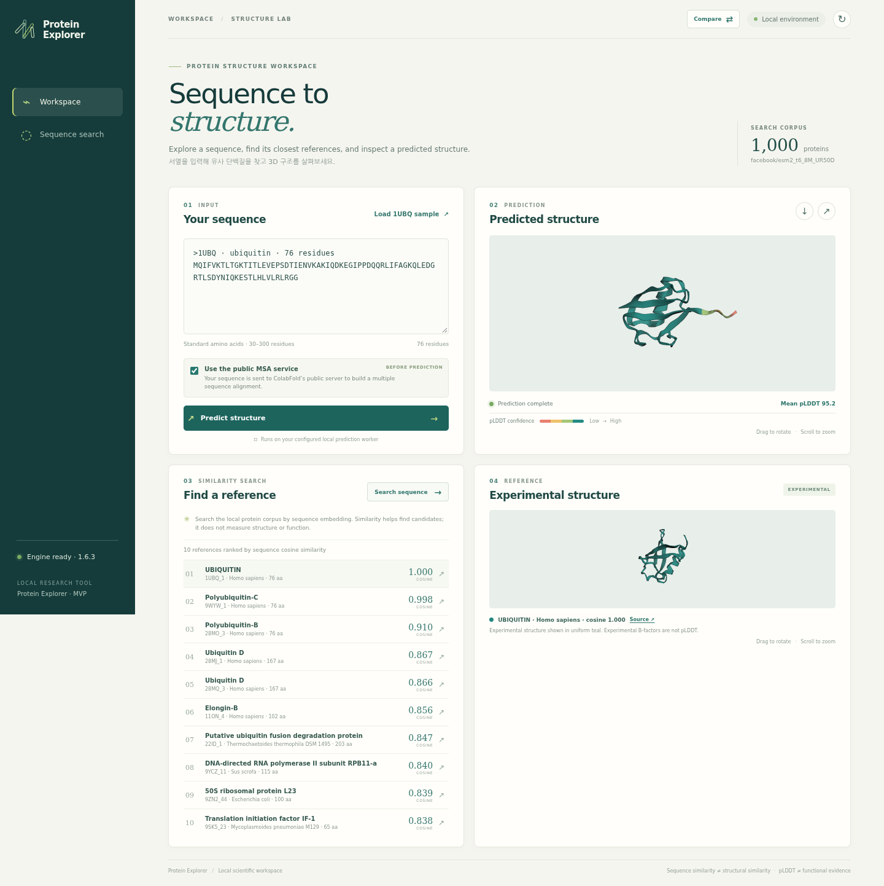
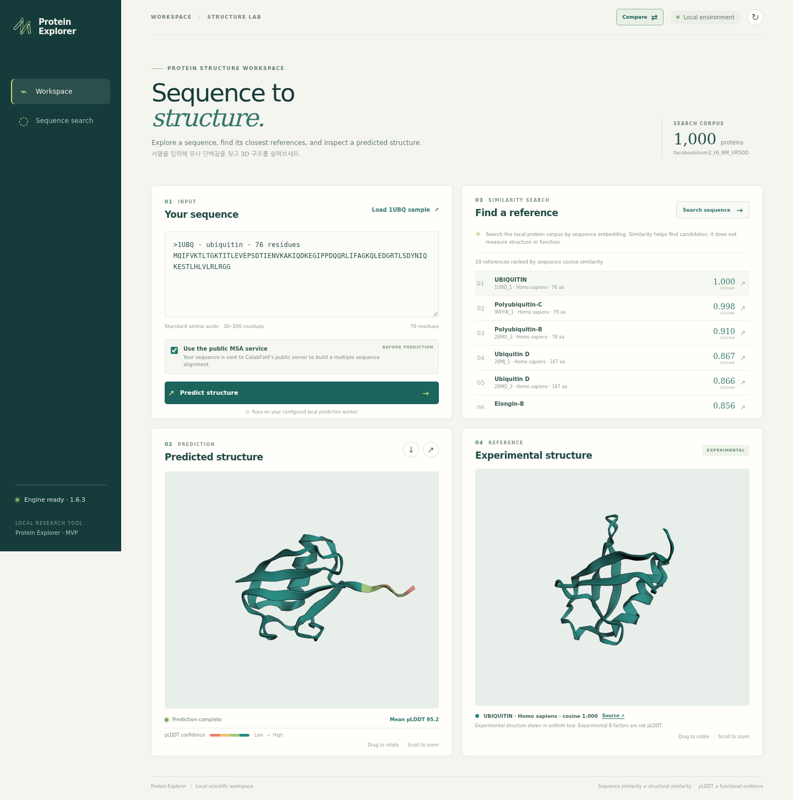
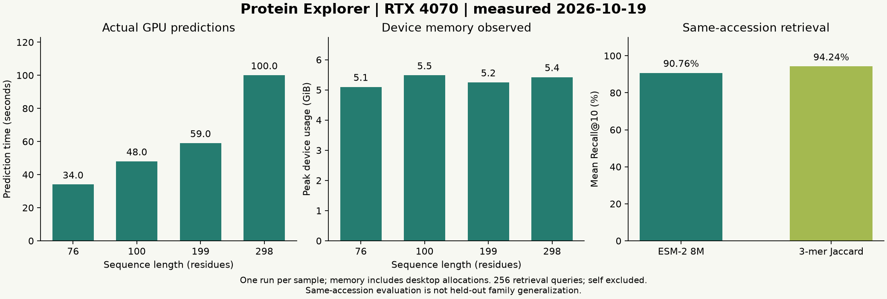
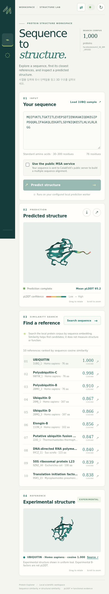
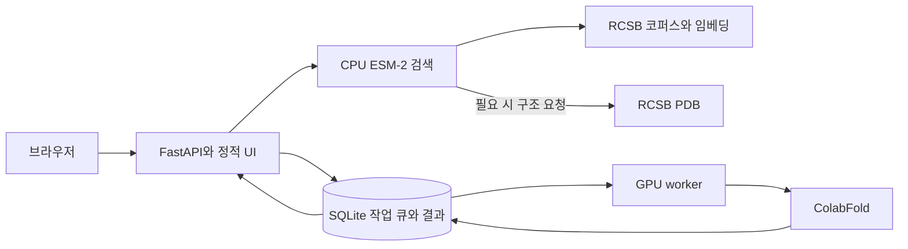

# Protein Explorer

[GitHub 저장소](https://github.com/pilsu-choi/protein-explorer) · 기본 브랜치: `dev`

Protein Explorer는 단백질 서열을 로컬에서 검색하고 GPU로 구조를 예측해 3D로 살펴보는 학습용 MVP입니다. FastAPI와 바닐라 JavaScript 화면을 제공하며, 3D 구조는 로컬에 포함된 3Dmol.js로 표시합니다. 기존 CLI도 계속 사용할 수 있습니다. 제품 요구사항과 검색 품질 기준은 [PRD](PRD.md), 상세 실행 절차는 [MVP 튜토리얼](wiki/2026-10-19-mvp-tutorial.md), 날짜별 기록은 [위키 목차](wiki/2026-10-19-index.md)에서 확인하세요.

## 화면









## 구조



## 빠른 시작

Docker Compose와 Docker의 NVIDIA GPU 지원이 필요합니다. 검색 화면과 CPU 검색은 GPU 없이 실행할 수 있지만, ColabFold 예측 워커에는 NVIDIA Container Toolkit이 연결된 NVIDIA GPU가 필요합니다. 검색 준비는 약 32 MB의 ESM-2 8M 가중치를 내려받습니다. 첫 예측은 ColabFold AlphaFold 가중치 약 3.7 GB를 별도로 내려받습니다.

저장소 루트에서 앱 이미지를 만들고 공개 구조 코퍼스를 준비합니다.

```bash
docker compose build app
docker compose --profile prepare run --rm prepare
```

그다음 앱과 GPU 워커를 시작합니다.

```bash
docker compose --profile gpu up -d --build app worker
```

브라우저에서 http://127.0.0.1:8080 을 엽니다. 포트를 바꾸려면 `PE_PORT`를 지정합니다. 기본 바인딩은 loopback 주소여서 로컬 컴퓨터에서만 접속할 수 있습니다. 앱만 실행하려면 `docker compose up -d app`을 사용하세요. 이 경우 검색은 사용할 수 있지만 워커가 없으므로 새 예측 작업은 제출할 수 없습니다.

컨테이너는 `protein_data` 볼륨에 SQLite 작업 상태, 검색 코퍼스, 구조 캐시와 예측 산출물을 보관하고 `model_cache` 볼륨에 모델 파일을 보관합니다. 처음부터 실행하는 과정과 GPU 문제 해결은 [튜토리얼](wiki/2026-10-19-mvp-tutorial.md)을 참고하세요.

## 현재 기능과 결과 해석

- 단일 FASTA 또는 아미노산 서열을 검증하고 예측 작업을 영속 SQLite 큐에 제출합니다. 워커는 heartbeat를 기록하고 중단된 작업을 복구합니다.
- 공개 RCSB PDB 코퍼스에서 정확히 같은 서열을 제거한 최대 1,000개 레코드를 준비합니다. 참조 구조 파일은 처음 선택할 때 가져와 캐시합니다.
- `facebook/esm2_t6_8M_UR50D` 모델의 고정 revision으로 잔기 토큰 평균 임베딩을 만들고 L2 정규화한 뒤 cosine 유사도 상위 10개를 반환합니다.
- 결과 구조와 검색된 참조 구조를 3D로 보고, 예측 구조의 pLDDT와 검색 점수를 확인하며 산출물을 내려받습니다.
- 예측 캐시는 정규화 서열, 추론 설정, 엔진 및 모델 가중치 fingerprint를 기준으로 하며 구조·점수 파일 checksum을 확인합니다.

검색 점수는 임베딩 유사도이고 기능이나 구조가 같을 확률이 아닙니다. pLDDT는 예측 구조의 신뢰도입니다. 현재 3D 화면은 나란히 구조를 보여주며 구조 정렬이나 RMSD를 계산하지 않습니다. 기본 공개 MSA 모드는 입력 서열을 ColabFold 공개 서비스로 전송합니다. 웹 화면은 공개 MSA만 제출하며, 비공개 입력에는 CLI/API의 `single_sequence` 모드를 사용하거나 로컬 MSA를 설정하세요.

현재 검색 평가에는 의도적으로 self-hit을 포함한 1,000개 sanity check와 같은 UniProt 그룹의 107개 그룹·256개 query에 대한 평가가 있습니다. Self-hit을 제외한 그룹 내 평가에서 ESM-2 Recall@10은 90.76%, 3-mer Jaccard 기준선은 94.24%였습니다. ESM-2 HitRate@10은 96.09%, 기준선은 99.22%였습니다. 이 초기 비교에서 단순 기준선이 더 높은 결과를 그대로 기록했습니다. 이 결과는 계열을 분리한 held-out 일반화 성능으로 해석하면 안 되며, 해당 검증과 후속 모델 선택은 남아 있습니다. 세부 수치와 한계는 [튜토리얼](wiki/2026-10-19-mvp-tutorial.md)과 PRD를 보세요.

RTX 4070에서 측정한 공개 단백질 네 개의 예측 시간은 34–100초였습니다. 전체 장치 메모리 피크는 5,223–5,616 MiB였고 데스크톱 사용량도 포함합니다. 이는 프로세스 단독 메모리나 보편적인 처리량 기준이 아닙니다. Docker 통합 GPU 검증에서 1UBQ 예측이 성공했고 동일 입력 재제출은 캐시를 재사용했습니다. CPU 검색도 1,000개 코퍼스에서 1UBQ를 0.99999994 cosine 점수로 첫 결과에 반환했습니다. 상세 결과는 [날짜별 검증 JSON](docs/validation/2026-10-19-results.json)에 있습니다.

Docker CPU 검색의 warm localhost API 지연은 모델이 이미 메모리에 올라온 상태에서 5회 측정한 중앙값 11.46 ms였습니다. 여기에는 API JSON 처리, ESM 질의 임베딩과 cosine 검색이 포함되며 모델 초기 로드와 브라우저 렌더링은 포함되지 않습니다. Playwright 화면 점검 7개도 페이지 오류 없이 통과했으며 예측 PDB 다운로드, 새로고침 뒤 작업 복원, 390 px 모바일 화면을 확인했습니다.

## 기존 CLI

Python 3.10 이상에서 편집 가능한 설치와 기존 검증·진단·예측 CLI를 사용할 수 있습니다.

```bash
python3 -m venv .venv
.venv/bin/python -m pip install -e '.[web]'
.venv/bin/protein-explorer --help
```

검색 의존성을 로컬에 설치해 별도로 실행하는 경우 `.[search]`를 추가합니다. GPU 추론은 별도 ColabFold 환경 또는 Compose의 GPU 워커를 사용합니다. 프로젝트 전용 `PROTEIN_EXPLORER_RUNTIME`과 예측 입력·MSA 정책은 [GPU 실행 안내](wiki/2026-10-19-gpu-runbook.md)에 설명되어 있습니다.

## 개발 상태

초기 MVP의 API, 웹 화면, 검색 인덱스 준비, SQLite 작업 큐와 캐시가 구현되었습니다. Docker GPU 예측·캐시 재사용과 CPU 검색 경로도 확인했습니다. 초기 same-UniProt 평가에서 단순 기준선이 ESM-2보다 높은 결과를 기록했으며 family-held-out 일반화 검증과 후속 모델 선택은 남아 있습니다. 전체 제품 상태와 다음 작업은 [PRD](PRD.md), 최근 진행은 [작업 기록](wiki/2026-10-19-work-log.md)을 참고하세요.
