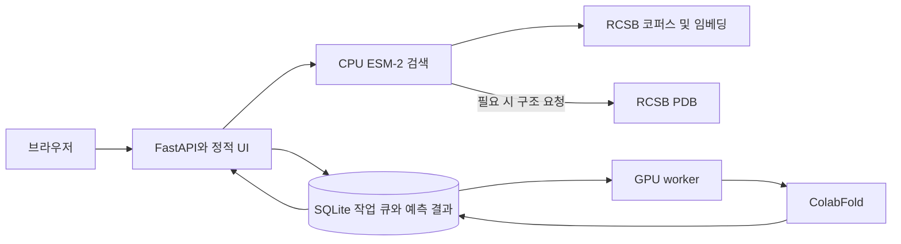

# 구성

Protein Explorer는 로컬 단일 사용자 앱이다. FastAPI가 API와 정적 화면을 제공하고, 바닐라 JavaScript와 로컬 배포한 3Dmol.js가 검색 결과와 구조를 표시한다. 구조 예측은 API 프로세스 안에서 장시간 실행하지 않고 별도의 GPU worker가 처리한다. 배포 구성은 [Docker Compose](../compose.yaml)에 있다.

앱과 검색은 CPU로 실행 가능하다. 검색 인덱스가 준비되면 질의 때만 모델을 lazy-load한다. 예측 제출에는 사용 가능한 worker heartbeat와 엔진 fingerprint가 필요하다. 앱 기본 포트는 호스트 loopback의 8080이다.

## 검색 데이터와 점수

`scripts/prepare_corpus.py`는 RCSB PDB에서 30~300잔기 공개 실험 단백질 최대 1,000개를 수집하고 정확 서열 중복을 제거한다. 출처, 생물종, accession, 체인과 구조 유형 정보를 보존한다. 코퍼스 파일과 벡터는 볼륨에 있으며, 참조 PDB 파일은 선택된 체인을 처음 사용할 때 가져와 구조 캐시에 저장한다.

인덱스와 질의는 동일한 `facebook/esm2_t6_8M_UR50D` revision `c731040fcd8d73dceaa04b0a8e6329b345b0f5df`를 사용한다. Padding과 special token을 제외하고 residue embedding 평균을 계산한 뒤 320차원 벡터를 L2 정규화한다. 벡터 내적을 cosine 순위로 사용한다. 이 값은 서열 임베딩의 유사도이며 구조 유사도나 기능 확률이 아니다.

실제 평가에서는 1,000개 self-hit sanity check와 같은 UniProt 그룹 평가를 구분한다. 그룹 평가에서는 ESM-2보다 3-mer Jaccard 기준선이 높았으며 family-held-out split도 아니다. 자세한 수치와 후속 평가 범위는 [평가 기록](2026-10-19-search-evaluation.md)에 있다.

## 예측 작업과 결과 캐시

SQLite는 작업 상태, 서열, 설정, 결과 위치 및 manifest를 저장한다. worker는 queued 작업을 원자적으로 claim하고 한 번에 하나씩 실행하며 heartbeat를 갱신한다. 프로세스가 끊긴 running 작업은 복구 시 재시도 가능한 실패 상태로 남는다. API는 결과 상태, 로그, 구조 및 다운로드 bundle을 제공한다.

캐시 키에는 정규화 서열, 결과를 바꾸는 추론 설정, 엔진 런타임 identity가 들어간다. 엔진 fingerprint는 런타임/모델 identity와 ColabFold 모델 가중치 checksum 정보를 포함한다. 캐시를 반환하기 전 성공 manifest, PDB와 score 산출물 형식, 저장된 checksum을 검증한다. 시간 제한은 추론 결과를 바꾸지 않으므로 키에서 제외한다.

기본 설정은 `alphafold2_ptm`, 모델 1개, recycle 3회, 공개 `mmseqs2_uniref_env` MSA다. 기본 MSA는 서열을 ColabFold 공개 서버로 전송하므로 화면은 서열 제출 전에 동의 checkbox를 요구한다. `single_sequence`는 공개 MSA 서비스 전송 없이 동작하지만 MSA를 생성하지 않는다.

## 화면 해석과 제한

예측 구조는 pLDDT 신뢰도 색상으로 표시하고 실험 참조는 단색으로 구분한다. 실험 구조의 B-factor는 pLDDT로 변환하지 않는다. 두 구조를 동시에 볼 수 있지만 현재 구현은 잔기 정렬, 구조 superposition, RMSD/TM-score를 제공하지 않는다.

family-held-out 검색 일반화 평가는 남아 있으므로 현재 검색 결과를 전반적 품질 보증으로 해석하지 않는다. 코퍼스는 최대 1,000개의 탐색 데이터다. 원격 GB10 환경의 ColabFold/JAX 호환성도 미검증이다. Docker GPU 예측 경로는 RTX 4070에서 1UBQ 성공과 동일 입력 캐시 재사용으로 확인했다. 통합 결과는 [작업 기록](2026-10-19-work-log.md)에 갱신한다.

관련: [PRD](../PRD.md), [MVP 튜토리얼](2026-10-19-mvp-tutorial.md), [평가 기록](2026-10-19-search-evaluation.md).
